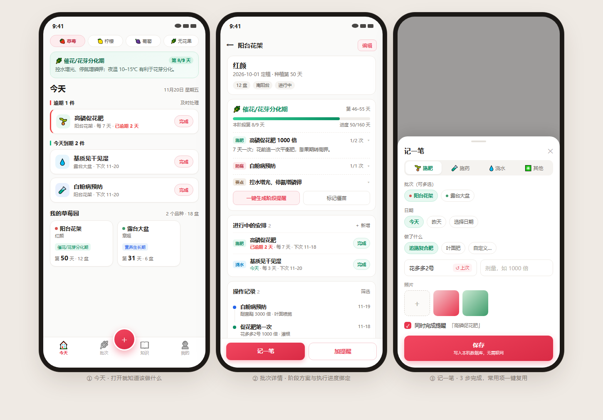
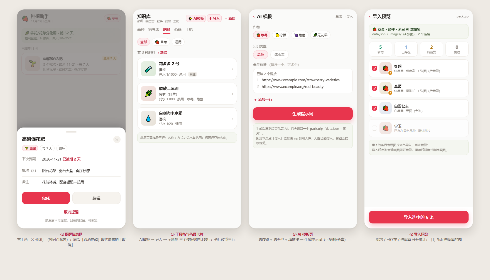

# 种植助手 · Android App 源码

个人自用多作物种植管理App：AI生成，用于管理阳台草莓，兼带柠檬、葡萄、无花果；管批次、记农活、拍照片、按生产阶段提醒施肥打药，知识库可以用外部AI批量扩充（AI出zip或json，App 只负责导入）。

- 应用名：**种植助手**
- 包名：`cn.zhongzhizhushou.planting`
- 技术栈：Flutter 3.50 / Dart 3.14 + SQLite（sqflite）+ 本地通知

---


## 主要功能

| 模块 | 能做什么 |
| --- | --- |
| 今天 | 已逾期 / 今天要做 / 接下来几天；顶部显示当前批次的生长阶段与操作要点 |
| 批次 | 按作物分组；定植日推算 10 个草莓阶段（柠檬/葡萄/无花果各 6 个，多年生按本年度萌芽日重置）；合并批次；逐盆标记存活/僵苗/死亡 |
| 记一笔 | 多批次一次记录（每个批次各一条）；施肥/施药可多行复配；浇水/其他；拍照（按批次或按盆，拍完可裁剪） |
| 提醒 | 多批次一次创建、列表合并展示；完成顺延、只做一次、取消提醒；每天 08:00 汇总 + 19:00 逾期补推 |
| 知识库 | 品种 / 病虫害 / 肥料 / 药品 / 土肥五个库，可增删改、可导入导出；品种与病虫害支持图片、裁剪与作物默认图 |
| 生产阶段 | 每个作物一套阶段，每个阶段可配施肥方案、病虫害预防、操作要点与提醒模板（一键生成整套提醒） |
| AI 扩充 | 生成提示词 → 交给豆包/DeepSeek → 拿回 zip → 导入品种或病虫害，图片可后续裁剪确认 |
| 数据 | 7 份 JSON 全量导出（图片内嵌 base64）、本机快照、条目级合并导入（新增/更新/跳过/删除四类） |

---

## 目录结构

```
share/
├─ README.md                 ← 本文件
├─ docs/
│  ├─ App设计文档.md          ← 架构、数据模型、业务规则、页面、导入导出（建议先读这篇）
│  └─ images/                ← 界面线框与真实截图
└─ app/                      ← Flutter 工程（可直接 flutter run / build）
   ├─ lib/
   │  ├─ main.dart           启动：初始化数据库、种子数据、通知
   │  ├─ app.dart            MaterialApp + 主题
   │  ├─ core/               工具、主题、图片存储、版本记录
   │  ├─ data/               模型、SQLite、仓库层、通知、导入导出、AI 提示词与数据包解析
   │  └─ ui/                 全部页面
   ├─ assets/seeds/          内置知识库（4 作物 28 阶段 60 提醒模板 / 20 品种 / 8 病虫害 / 4 土肥）
   ├─ test/                  20 个测试（数据层 + UI 冒烟 + 截图）
   └─ android/               Android 工程（Gradle、Manifest、图标）
```

## 快速开始

```bash
# 1. 环境：Flutter 3.50+（含 Dart 3.14）、JDK 17、Android SDK（compileSdk 37）
flutter --version
java -version

# 2. 安装依赖并跑起来
cd app
flutter pub get
flutter run                     # 接上手机或模拟器

# 3. 测试与打包
flutter test                    # 20 个用例
flutter analyze                 # 应为 0 error
flutter build apk --release     # 产物：build/app/outputs/flutter-apk/app-release.apk
```

## 数据与隐私

- 数据存于 App 私有目录：`files/planting.db`（SQLite）+ `files/images/`（照片）。
- 卸载即清空。**备份方式**：App 内「我的 → 数据管理 → 全部导出」，可导出 7 份 JSON（图片以 base64 内嵌），换机后用「导入」还原。
- 内置知识库只是文本资料，不含任何账号、接口或第三方服务信息。
- 数据文件的格式标识：源码快照 1.4.0 为 `planting.data`，1.5.0 安装包为 `caomeiyuan.data`（见 `lib/data/transfer.dart` 的 `kFormat` 与 `assets/seeds/*.json` 的 `format` 字段）；两边的导出文件不能直接互导。
  **如果你手上还有另一份同款 App 导出的 JSON**，两边 `format` 必须一致才能互相导入；不一致时只改这两个地方即可。

## 文档索引

| 文档 | 内容 |
| --- | --- |
| [App设计文档](docs/App设计文档.md) | 架构分层、13 张表、阶段/提醒/盆位/多批次提醒/病虫害多作物等业务规则、31 个页面、通知、数据文件与 AI 数据包、构建与扩展指南 |
| 界面参考 | `docs/images/app-real-*.png`（真实渲染截图）、`app-mockup.png`（三屏线框）、`v13-mockup.png`（按盆拍照方案）、`v14-mockup.png`（多批次提醒 / AI 模板） |
