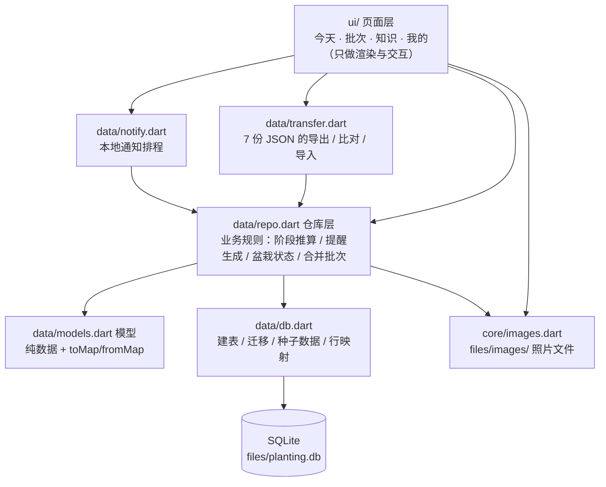
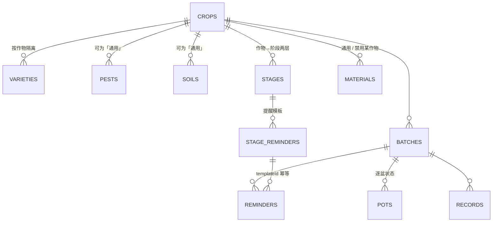
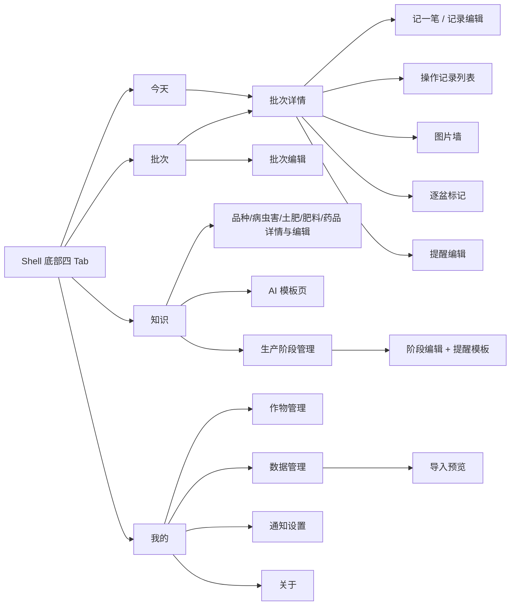

# 种植助手 · App 设计文档

> 版本 1.4.0 ｜ 数据库 schema v8 ｜ 数据文件 schemaVersion 4 ｜ 2026-11-23
> 配套源码：`../app/`（Flutter 3.50 / Dart 3.14）

---

## 1. 产品定位

一个**只给自己用**的盆栽种植管理 App。核心诉求不是"记住所有知识"，而是**在正确的时间提醒你做正确的事**，并且记录能翻得回去。

| 维度 | 说明 |
| --- | --- |
| 使用场景 | 阳台 / 天台盆栽，随手记、随手拍，不需要电脑 |
| 作物范围 | **草莓为主**（默认作物、不可删除），附带柠檬、葡萄、无花果；可自行新增任意作物 |
| 联网 | **完全离线**：不登录、不注册、无服务器、**Android 清单里没有 INTERNET 权限** |
| 数据归属 | 全部在本机 SQLite + 本机图片目录；卸载即清空，靠"导出 JSON"备份 |
| 设计取舍 | 宁可少功能，也不引入账号体系与云端；宁可手动维护知识库，也不做远程拉取 |

### 1.1 设计原则

1. **首屏即答案**：打开就看到"今天要做什么"，不需要点进任何页面。
2. **一步记录**：干完活从任意页按 FAB「记一笔」，两次点击内完成。
3. **数据可带走**：任何配置（知识库、阶段、批次）都能导出成 JSON，换机可还原。
4. **不静默丢数据**：删除有确认，导入有预览，合并有"新增/更新/跳过"计数。
5. **无网络也要能跑**：所有依赖本地化；不申请网络权限是"隐私承诺"而非"懒得做"。

---

## 2. 技术架构

### 2.1 技术选型

| 层 | 选型 | 理由 |
| --- | --- | --- |
| UI | Flutter 3.50（Material 3） | 一套代码、无原生桥接成本；`CustomPaint` 方便自绘裁剪框 |
| 状态 | `setState` + `ValueNotifier`（`app_state.dart` 的 `refreshTick`） | 页面级状态很轻，不值得引入 Riverpod/Bloc |
| 存储 | SQLite（`sqflite`） | 关系型查询（按作物/批次/到期日过滤）比 JSON 文件省心 |
| 通知 | `flutter_local_notifications` + `timezone` | 需要精确到分钟的本地定时，且支持重启后恢复 |
| 图片 | `image_picker` + 自绘裁剪页 | 拍照/相册、裁剪到任意比例、压缩到可控体积 |
| 文件 | `file_picker`（导入）+ `share_plus`（导出）+ `path_provider` | 导出走系统分享，导入走文件选择器 |
| 格式化 | `intl`（`zh_CN`） | 日期/星期显示 |
| 本地化 | `flutter_localizations` | 长按菜单、日期选择器全中文，不依赖系统语言 |
| 压缩 | `archive` | 只用于**解包** AI 生成的数据包，不发起任何网络请求 |

**没有任何 HTTP 客户端依赖**（无 dio/http），这是刻意的。

### 2.2 分层



- **页面不写 SQL**：所有查询/写入走 `Repo.instance`。
- **业务规则集中在 Repo**：阶段怎么算、提醒哪天生成、盆位怎么同步，只有一处实现，页面只调用。
- **通知是"投影"**：`Notify.reschedule()` 每次数据变更后重排全部通知，不做增量维护（简单且不会残留旧闹钟）。

### 2.3 目录

```
lib/
├─ main.dart        启动流程：ensureInitialized → 日期本地化 → 建库灌种子 → 通知初始化 → runApp
├─ app.dart         MaterialApp（主题、标题）
├─ core/
│  ├─ util.dart     日期工具、颜色板、枚举归一（非法类型 → 「其他」）、id 生成
│  ├─ theme.dart    色板、字号、Card/Button/Input 皮肤、通用小组件
│  ├─ images.dart   图片落盘（保存/读取/删除/base64 互转）
│  └─ changelog.dart 版本更新记录（关于页的数据源）
├─ data/
│  ├─ models.dart   13 张表对应的模型 + PotStats/StageSnapshot 等派生结构
│  ├─ db.dart       建表、v1→v8 迁移、种子数据导入、JSON→行映射
│  ├─ repo.dart     仓库层（见第 4 章）
│  ├─ notify.dart   通知通道与排程
│  ├─ transfer.dart 数据文件信封、差异比对、事务导入
│  ├─ reminder_group.dart 同 groupId 的多批次提醒 → 一个视图对象
│  ├─ ai_prompt.dart      生成给外部 AI 的提示词（输出契约 + 硬约束 + 自检）
│  └─ ai_import.dart      解析 AI 产出的 zip 数据包并落库
└─ ui/              23 个文件 / 31 个页面与组件（见第 5 章）
```

### 2.4 启动流程

```dart
WidgetsFlutterBinding.ensureInitialized();
await initializeDateFormatting('zh_CN');     // intl
await Images.init();                          // 图片目录
await Repo.instance.crops();                  // 首次访问触发建库 + 灌种子
await Notify.instance.init();                 // 时区、通道、开关
if (await Repo.instance.setting('notify') != '0') await Notify.instance.reschedule();
runApp(const PlantingApp());
```

首次启动会读 `assets/seeds/*.json` 灌入内置知识库，**不灌任何示例批次**（打开就是空园子）。种子只在"库为空"时写入，升级不会覆盖用户改过的数据。

---

## 3. 数据模型

### 3.1 实体关系



### 3.2 表结构（13 张表 ＝ 11 张业务表 + 2 张元数据表）

> **v1.4 新增列**：`reminders.groupId`（多批次提醒共用的组号）、`pests.crops`（JSON 数组，一病可绑多作物）、
> `varieties.imgPending` / `pests.imgPending`（AI 导入后"待裁剪"标记，列表缩略图显示橙色「!」）。

> 所有业务表都带 `rev INTEGER`、`createdAt/updatedAt/deletedAt TEXT`；删除一律**软删除**（写 `deletedAt`），页面查询过滤 `deletedAt IS NULL`。这样才能把"删除"同步进导出文件而不复活。

#### crops（作物）

| 字段 | 说明 |
| --- | --- |
| `id` | `crop_strawberry` / `crop_lemon` … |
| `name` `emoji` `color` | 显示名、图标、主题色 |
| `lifeCycle` | `annual` 一年生 / `perennial` 多年生 |
| `cycleStart` | 一年生存 `plantDate`（看批次）；多年生存 `MM-DD`（每年萌芽日） |
| `unit` | 计数单位：盆 / 株 |
| `isDefault` | 默认作物（草莓），**不可删除、不可改生命周期** |
| `enabled` | 停用后按规则从今天/批次页隐藏（见 4.7） |
| `image` | 默认图（知识库条目缺图时兜底），相对 `images/` 路径 |

#### varieties / pests / soils / materials（四类知识库）

| 表 | 关键字段 | 说明 |
| --- | --- | --- |
| `varieties` | `name category characteristics suitable care yieldText taste sweetness sweetnessStar fruitSize sizeStar heatResistance heatStar` | 品种；三个 `*Star` 是 0~5 星 |
| `pests` | `name category symptoms cause treatment prevention` | `category`：病害 / 虫害 |
| `soils` | `name category description ingredients method tips` | 配土 / 堆肥 / 液肥 |
| `materials` | `kind`(`fertilizer`/`medicine`) `name ratio method notes scope disabledCrops` | 自己买的肥和药；`scope`=通用/禁用，`disabledCrops` 为作物 id 的 JSON 数组 |

四表共有：`crop`（作物 id，或 `通用`）、`image`、`incomplete`（待完善角标）、`source`（`builtin`/`manual`）、`sortOrder`。

#### stages / stage_reminders（生产阶段与提醒模板）

| stages | 说明 |
| --- | --- |
| `crop` | 所属作物 |
| `startDay` `endDay` | **相对本年度基准日**的天数（草莓允许从 -3 开始：苗前消毒） |
| `fertilizerPlan` `pestControl` `operationTips` | 三段文案，批次详情直接展示 |

| stage_reminders | 说明 |
| --- | --- |
| `stageId` | 属于哪个阶段 |
| `kind` | 施肥 / 施药 / 浇水 / 其他 |
| `startOffset` | 阶段内第几天开始（1 起） |
| `intervalDays` `repeatCount` | 每 N 天一次、共 Y 次 |
| `enabled` | 关闭后生成时跳过 |

内置：**4 作物 · 28 阶段 · 60 条模板**。草莓 10 阶段（苗前消毒 -3~0 → 采收期 126~160），另三作物各 6 阶段。

#### batches（批次）

| 字段 | 说明 |
| --- | --- |
| `crop` `name` | 作物、批次名（"阳台花架"） |
| `variety` `varietyId` | 品种名（冗余存）、品种库 id（可为空=自定义） |
| `plantDate` | 定植日（一年生基准日） |
| `cycleStartDate` | 本年度开始日（多年生基准日，`newYear()` 时重置） |
| `potCount` `status` `location` `color` `notes` `sortOrder` | 展示用 |
| `growthOffsetDays` | 进度补偿：导入或"苗已长一段"时整体后移 |
| `stuntedSince` | 僵苗冻结起点（**全批无存活盆**才设置） |
| `photoMode` | `batch` 按批次 / `pot` 按盆 |
| `archived` | 归档（不删除但不在常规列表出现） |

#### pots（盆栽，v1.3）

| 字段 | 说明 |
| --- | --- |
| `batchId` `idx` | 第几盆，**盆号永不复用、永不重排** |
| `state` | `alive` 存活 / `stunted` 僵苗 / `dead` 死亡 |
| `note` `changedAt` | 变更备注（如"根腐"）、变更日期 |

`potCount` 是"当前启用的盆数"，`pots` 是"历史上出现过的所有盆"。改小盆数只把 `idx > potCount` 的盆停用，历史记录仍指向原盆号。

#### records（操作/拍照记录）

| 字段 | 说明 |
| --- | --- |
| `batchId` `type` `date` `title` `notes` | `type`：施肥/施药/浇水/拍照/其他 |
| `products` | 复配产品数组 JSON：`[{name,dosage,method}]`；旧字段 `productName/dosage/method` 保留兼容 |
| `images` | 图片相对路径数组 JSON |
| `potIndex` | 0=批次级；≥1=第几盆（拍照模式为"按盆"时） |
| `imgW` `imgH` | 首图原始宽高，用于按比例显示（避免被裁切变形） |
| `stageId` `reminderId` | 当时所处阶段 / 由哪条提醒完成产生 |

#### reminders（提醒实例）

| 字段 | 说明 |
| --- | --- |
| `batchId` `kind` `title` | |
| `intervalDays` | 循环间隔（单次提醒也要求 ≥1，用于展示） |
| `nextDueAt` | **下次到期日**（注意不是"上次完成日"） |
| `lastDoneAt` | 上次完成日 |
| `active` `isOneTime` | 单次提醒完成后 `active=false` |
| `templateId` `stageId` | 由哪个阶段模板生成，格式 `模板id#第几次`，用于幂等 |

#### lib_meta / settings

- `lib_meta(kind, libraryId, name, updatedAt, revision)`：每份数据文件的"库身份 + 库更新时间"，导入时做快速门禁。
- `settings(k, v)`：`notify`（通知总开关）等。

---

## 4. 核心业务规则

### 4.1 阶段推算（一年生 vs 多年生）

```dart
DateTime batchBaseDate(Batch b) {
  final isAnnual = b.crop.endsWith('_strawberry') ||
                   (b.plantDate.isNotEmpty && b.cycleStartDate.isEmpty);
  if (isAnnual) return parseDay(b.plantDate)!;          // 草莓：定植日算起，一次性
  final md = crop.cycleStart;                            // 柠檬 03-01 / 葡萄 03-15 / 无花果 03-20
  var base = thisYear(md);
  if (today.isBefore(base)) base = lastYear(md);         // 还没到今年的萌芽日 → 用去年
  return base;
}

int dayInCycle(Batch b) {
  final frozen = parseDay(b.stuntedSince);               // 僵苗冻结时钉在冻结日
  return daysBetween(batchBaseDate(b), frozen ?? today) + 1 - b.growthOffsetDays;
}
```

- `snapshot(batch)` 在 `stages`（按 `crop`）里找 `startDay <= dayInCycle <= endDay` 的阶段；超出范围返回首/末阶段并标记 `dayInStage` 夹紧（不会抛异常）。
- 草莓的 `startDay` 可以是 **-3**（苗前消毒在定植前），所以 `dayInCycle` 可能为负。

### 4.2 阶段提醒一键生成

```dart
for (模板 t in 当前阶段模板.where(enabled)) {
  for (i in 0..t.repeatCount-1) {
    tid = '${t.id}#${i+1}';
    if (已存在相同 templateId) continue;                 // 幂等：重复点不会重复生成
    due = base + (stage.startDay + t.startOffset - 1 + i * t.intervalDays);
    if (due < today) continue;                            // 跨年/补录时跳过已经过去的日子
    插入 reminder(nextDueAt: due, templateId: tid, stageId: stage.id);
  }
}
```

### 4.3 提醒完成

| 类型 | 行为 |
| --- | --- |
| 循环（`isOneTime=false`） | `lastDoneAt=完成日`、`nextDueAt=完成日+intervalDays`，`active` 保持 true |
| 单次（`isOneTime=true`） | `lastDoneAt=完成日`、`active=false`，不再出现在"接下来几天" |

完成后统一 `Notify.reschedule()`，让通知跟上新的到期日。

### 4.4 僵苗 / 死亡（v1.3 起逐盆）

- 逐盆状态：`alive / stunted / dead`，可写备注与日期，可改回。
- **只有"全批没有任何存活盆"** 时才 `stuntedSince = today`，冻结阶段进度；此时 `dayInCycle` 钉在冻结日。
- 恢复（任一盆改回存活）时：把冻结期间的天数累加进 `growthOffsetDays`，进度**不倒退、也不跳过**。

```dart
// reevaluateStunt
final st = await potStats(batchId);        // alive/stunted/dead
if (st.allGone && b.stuntedSince == null) { b.stuntedSince = today; }
else if (!st.allGone && b.stuntedSince != null) {
  b.growthOffsetDays += daysBetween(parseDay(b.stuntedSince), today);
  b.stuntedSince = null;
}
```

### 4.5 多年生「开启新一年」

柠檬/葡萄/无花果每年萌芽时，在批次详情点「开启新一年」：

1. `cycleStartDate = 今年的 MM-DD`（可手改）、`growthOffsetDays = 0`、`stuntedSince = null`；
2. 上一年度生成的循环提醒 `active = false`（不删，历史可查）；
3. 写一条"开启新一年"记录；
4. 同一株只保留一条批次（不新建）。

### 4.6 多批次记一笔 & 复配产品

- 「记一笔」先按作物分组列出**所有有批次的作物**，勾选 N 个批次 → 保存时**每个批次各写一条记录**（各自带自己的 `stageId`）。
- 选「施肥/施药」时可加多行产品（复配）：每行可从自建肥料库/药品库点选，自动带出兑水比例与方式；备注只有一个。
- 从库中选产品时按批次作物过滤：`scope=禁用` 且该作物在 `disabledCrops` 里的条目不出现。

### 4.7 停用作物在界面上的可见性

```sql
SELECT * FROM crops
WHERE deletedAt IS NULL
  AND (enabled = 1
       OR id IN (SELECT crop FROM batches WHERE deletedAt IS NULL AND archived = 0))
ORDER BY sortOrder, createdAt;
```

即：**停用且没有任何在册批次**的作物，从「今天」「批次」「新建批次」里隐藏；一旦还有批次就不隐藏（避免数据"消失"）。知识库仍可正常查看该作物的条目。

### 4.8 盆位同步（不重排）

```dart
syncPots(b):                     // 每次保存批次后调用
  for (i in 1..b.potCount) upsert pot(idx=i, state: 保持已有状态 或 'alive');
  for (i in potCount+1..maxIdx) 停用（软删）；
```

- 盆 10 永远是盆 10；把 12 盆改成 10 盆，第 11、12 盆被停用，历史照片仍挂在"盆11/盆12"。
- 死亡盆**不能再新拍**（点它提示），但历史照片可查看。

### 4.9 类型与枚举的归一

用户/导入数据里的非法类型不能崩页面：

```dart
const kRecordTypes = ['施肥','施药','浇水','拍照','其他'];
String normRecordType(String? t) => kRecordTypes.contains(t) ? t! : '其他';
```

同理 `normKind`（提醒类型）。**任何从数据库/JSON 读到的枚举都必须过一遍归一**。这是历史教训：早期版本遇到未知类型会整页白屏。

### 4.10 多批次提醒（组）

一次「新建提醒」可以勾多个批次，给每个批次各建一条 `reminders` 行，共用同一个 `groupId`：

```dart
final gid = selected.length > 1 ? newId('rg') : '';
for (final bid in selected) {
  final r = Reminder(...)..batchId = bid..groupId = gid;
  await repo.saveReminder(r);
}
```

| 位置 | 行为 |
| --- | --- |
| 今天页 | 按 `groupId` 合并成一张卡，副标题「3 个批次 · 施肥 · 每 7 天」，到期日取组内**最早**一条 |
| 批次详情 | **不合并**，每个批次只看到自己那条 |
| 提醒信息框 | 「完成」时问"只完成这一条 / 全部 N 条"；「编辑」改的是整组共享字段（标题/类型/间隔/备注） |
| 取消提醒 | `active=0` + `deletedAt=今天`（软删除，记录保留可恢复）；`wholeGroup=true` 时整组一起取消 |

`ReminderGroup`（`data/reminder_group.dart`）是这个合并视图的唯一来源：按 `groupId` 分组、单条各自成组、按 `dueAt` 升序。

### 4.11 病虫害的多作物匹配

病虫害可以是「通用」（影响所有作物），也可以绑定多个作物（白粉病、红蜘蛛这类跨作物病害）：

```dart
bool hits(String cropId) =>
    crop == '通用' || crops.contains(cropId) || (crops.isEmpty && crop == cropId);
```

SQL 侧用 `crops LIKE '%"$cropId"%'` 匹配 JSON 数组。新增条目默认绑定当前顶部筛选的作物，编辑页可切「通用 / 指定作物」并多选。

---

## 5. 页面与交互

### 5.1 导航



### 5.2 页面清单

| # | 页面 | 文件 | 关键点 |
| --- | --- | --- | --- |
| 1 | 今天 | `today.dart` | 顶部阶段条（当前批次阶段 + 操作要点）；**已逾期 / 今天要做 / 接下来几天** 三组；作物批次卡；其它作物折叠行 |
| 2 | 批次列表 | `batch_list.dart` | 按作物分组；显示天数/盆数/阶段/待办数/`已死亡 N 盆`/`僵苗 N 盆`；合并批次（选目标 + 勾源） |
| 3 | 批次编辑 | `batch_edit.dart` | 作物选择；品种手动输入（自动入库）或从库选；一年生=定植日，多年生=本年度萌芽日；**拍照模式**（按批次/按盆） |
| 4 | 批次详情 | `batch_detail.dart` | 头部卡（品种/天数/盆数/位置/备注）；阶段卡（进度条 + 施肥方案/病虫害预防/操作要点）；`标记死亡/僵苗`；生成阶段提醒；进行中的安排（可直接勾完成）；记一笔四按钮；操作记录 + 拍照记录各 5 条 + 更多 |
| 5 | 记一笔 | `record_edit.dart` | 多批次勾选；类型 施肥/施药/浇水/拍照/其他；复配产品多行；拍照模式只留"照片 + 备注" |
| 6 | 操作记录列表 | `record_list.dart` | 每页 30 条，滚动加载；分类筛选 |
| 7 | 记录详情 | `record_list.dart` | 上一条/下一条直接翻 |
| 8 | 图片墙 | `photo_wall.dart` | 盆号筛选（绿=拍过、红=没拍）；按 `imgW/imgH` 比例完整显示；双指放大；单张删除 |
| 9 | 逐盆标记 | `pot_state.dart` | 汇总卡；每盆三按钮 + 备注；改回存活 |
| 10 | 提醒编辑 | `reminder_edit.dart` | 类型/标题/**多批次勾选（按作物分组，可全选）**/下次到期日/间隔/只做一次/备注；编辑态批次只读 |
| 11 | 知识库 | `knowledge.dart` | 5 个 Tab：品种 / 病虫害 / 肥料 / 药品 / 土肥；作物 chips；右上阶段管理；工具条「AI模板 / 导入 / ＋新增」 |
| 12-16 | 品种/病虫害/土肥/肥料/药品 详情 | `kb_detail.dart` | 顶部大图（缺图用作物默认图）；只读详情 + 编辑表单 |
| 17 | 作物管理 | `crop_manage.dart` | 默认作物不可删/不可改生命周期；停用开关；默认图 |
| 18 | 作物编辑 | `crop_manage.dart` | 一年生/多年生、萌芽日、单位、颜色、图标 |
| 19 | 生产阶段管理 | `stage_manage.dart` | 选作物 → 阶段列表（每行显示提醒条数） |
| 20 | 阶段编辑 | `stage_manage.dart` | 起止天/色板/三段文案 + 提醒模板增删改（类型、阶段第几天、间隔、次数、启用） |
| 21 | 数据管理 | `data_manage.dart` | 7 份文件卡（编号/更新时间/条目数）；导出/分享；本机快照；导入 |
| 22 | 导入预览 | `data_manage.dart` | 新增/更新/跳过/删除四统计 + 逐条勾选 + 库编号不一致警告 |
| 23 | 我的 | `me.dart` | 统计卡 + 入口分组 |
| 24 | 通知设置 | `me.dart` | 总开关、精确闹钟授权、测试通知 |
| 25 | 关于 | `me.dart` | 名字 + 版本时间；**更新记录（各版本要点）**；长按显示包名/版本/schema |
| 26 | 裁剪页 | `image_crop.dart` | 自由 / 1:1 / 4:3；拖动缩放；输出 ≤1600px |
| 27 | 图片查看 | `photo_wall.dart` | 黑底 + 双指缩放 + 删除 |
| 28 | Shell | `shell.dart` | IndexedStack 保活 + 底部导航 + 中央 FAB |
| 29 | AI 模板 | `ai_template_page.dart` | 选作物 / 知识类型 → 填链接 → 生成提示词 → 复制或分享 → 导入 zip |
| 30 | 提醒信息框 | `reminder_sheet.dart` | 右上 ✕ 关闭；完成（组内可全选）/ 编辑 / 取消提醒（软删） |
| 31 | AI 导入结果 | `ai_import.dart` | 新增/更新/跳过/图片数 + 失败原因；成功后回列表看「!」 |

### 5.3 界面规范

| 项 | 值 |
| --- | --- |
| 主色 | `#E8354D`（草莓红），深色 `#C0233B`，浅底 `#FDECEE` |
| 中性 | 纸底 `#FAFAF9`、分割线 `#EDE9E4`、正文 `#1F1B18`/`#56504A`/`#8C857E` |
| 语义 | 绿 `#0B8F63`、蓝 `#3E7BC4`、琥珀 `#C98A16` |
| 圆角 | 卡片 16、按钮 14、图片 12 |
| 字号 | 标题 19/700、正文 14、副文 12.5、微标 11 |
| 组件 | `SectionTitle`（带右侧"更多/计数"）、`EmptyHint`、`Pill`、`ChoiceRow`、`PickTile`、`ImageField`、`LocalImage` |

### 5.4 空态与兜底

- 无批次：今天页展示引导 + 「新建批次」按钮。
- 无图片：显示作物默认图（作物管理里可设），再没有就显示占位图标。
- 阶段为空（新加作物还没配阶段）：不崩，卡片提示"去生产阶段管理配置"。
- 枚举非法：归一到「其他」。

---

## 6. 通知系统

| 通知 | id | 时间 | 内容 |
| --- | --- | --- | --- |
| 每日汇总 | `1000` | 每天 08:00 | "今天到期 N 件，已逾期 M 件"（无则鼓励语） |
| 逾期补推 | `1001` | 每天 19:00 | 逾期未完成的提醒（最多 3 条 + "等 N 件"） |
| 单条提醒 | `2000 + hash(提醒id)` | 到期日 09:00 | 标题 + 批次 · 类型 · 每 N 天 |

- 全部使用 `AndroidScheduleMode.exactAllowWhileIdle`；两个每日推送用 `matchDateTimeComponents: time` 自动每天重复。
- 单条提醒只排**未来 30 天**内的（每次数据变更重排，滚动覆盖）。超过 30 天的会在之后的某次重排里补上。
- `reschedule()` 的策略是 `cancelAll()` 后全量重排：不会残留已删除提醒的旧闹钟。
- 权限：`POST_NOTIFICATIONS`、`SCHEDULE_EXACT_ALARM` / `USE_EXACT_ALARM`、`RECEIVE_BOOT_COMPLETED`（重启后由 FLN 的 BootReceiver 重新排程）。
- 设置页有「测试通知」，用于验证 ROM 是否拦截。

---

## 7. 图片管线

```
相机/相册 ──ImagePicker──► 原始图 (jpeg)
        ──裁剪页──► PictureRecorder 输出 ≤1600px PNG
        ──Images.save──► files/images/img_<时间戳>_<n>.png
        ──records.images 存相对路径 ["images/…png"]
显示：LocalImage(ref) → Images.pathOf(ref) → Image.file
导出：Images.dataUri(ref) → data:image/png;base64,…
导入：Images.saveDataUri() → 落盘并还原相对路径
```

- 图片引用一律存**相对路径**（`images/xxx.png`），不存绝对路径，换机/迁移才有效。
- 删除记录时 `Repo.deleteRecord` 会先删文件再软删记录，避免垃圾文件。
- 导出内嵌 base64，是为了"一台手机导出的文件，能在另一台手机完整恢复"。
- AI 导入的图先落盘并标 `imgPending`，列表缩略图右下角显示橙色「!」；点缩略图进裁剪页，
  `cropExistingPhoto()` 保存新图后会**删掉原图**并清除标记（原图与裁剪图都只在本机）。

---

## 8. 数据文件与导入导出

### 8.1 七份文件

| 文件 | `kind` | 内容 |
| --- | --- | --- |
| `planting-garden.json` | `garden` | 批次 + 记录 + 提醒 + 盆栽状态 |
| `planting-varieties.json` | `variety` | 品种库 |
| `planting-pests.json` | `pest` | 病虫害库 |
| `planting-soil.json` | `soil` | 土肥库 |
| `planting-fertilizer.json` | `fertilizer` | 肥料库 |
| `planting-medicine.json` | `medicine` | 药品库 |
| `planting-stages.json` | `stage` | 作物定义 + 生产阶段 + 提醒模板 |

### 8.2 文件信封

```json
{
  "format": "planting.data",
  "kind": "variety",
  "schemaVersion": 4,
  "libraryId": "lib_variety_3c07a1b2",
  "name": "品种库",
  "updatedAt": "2026-11-21T17:20:00+08:00",
  "revision": 12,
  "appVersion": "1.4.0",
  "count": 20,
  "items": [ { "id": "var_xxx", "rev": 3, "updatedAt": "…", "deletedAt": null, … } ]
}
```

- `format` 不匹配 / `kind` 不匹配 / `schemaVersion > 4` → 直接拒绝并提示。
- `schemaVersion < 3` → 自动迁移（补 `potIndex/imgW/imgH`、`photoMode`、`pots[]`）。
- `schemaVersion < 4` → 补 `reminders[].groupId`、`pests[].crops`、`imgPending`。
- `garden` 不用 `items`，而是 `batches[] / records[] / reminders[] / pots[]`。
- 条目公共字段：`id`、`rev`、`createdAt`、`updatedAt`、`deletedAt`（墓碑）、`sortOrder`。

### 8.3 三层合并决策

```
① 库身份：libraryId 不同 → 提示"这是另一份库"，仍允许导入（走条目级合并）
② 库时间：文件 updatedAt <= 本地 → 提示"本地已是最新"，整份跳过（快速门禁）
③ 条目级：逐条比 updatedAt
     本地没有            → 新增
     文件更新（且未删除） → 更新
     文件更旧             → 跳过
     文件带 deletedAt     → 删除（墓碑传播），但本地有更新的修改则保留
```

伪代码：

```dart
ImportPlan plan(File f, Local lib) {
  if (f.libraryId != lib.libraryId) warn('库编号不同');
  if (f.updatedAt <= lib.updatedAt) return plan.markAllSkip('本地已是最新');
  for (item in f.items) {
    final local = lib.byId(item.id);
    if (local == null) plan.add(item);
    else if (item.updatedAt > local.updatedAt) {
      if (item.isDeleted) plan.remove(local); else plan.update(item);
    } else plan.skip(item);
  }
}
```

- 导入前自动做一次**本机快照**（`files/export/backup/<yyyyMMddHHmm>/`），失败可回滚心理预期。
- 应用时开**单事务**：任一写入失败整体回滚，不留半份数据。
- 导入预览页必须显示：文件卡（编号/时间/条数）、库编号警告、四类统计、逐条勾选。

### 8.4 边界情况

| 情况 | 处理 |
| --- | --- |
| `format` 不是 `planting.data` | 拒绝，提示"不是本 App 的数据文件" |
| 条目缺 `id` | 生成新 id，视为新增 |
| 同文件内 id 重复 | 后者覆盖前者，计数提示 |
| 记录指向不存在的批次 | 保留但与批次解绑显示"未知识批次"（不删数据） |
| `templateId` 指向已删除模板 | 提醒保留，按普通提醒展示 |
| 图片路径不存在 | 显示占位图，不报错 |
| 文件 > 50MB | 提示可能较慢，需二次确认 |
| 时钟回拨（`updatedAt` 在未来） | 视为最新，但记录一条警告 |
| `schemaVersion` 高于 4 | 拒绝，提示升级 App |

### 8.5 AI 数据包（zip）

知识库「AI模板」页把一份提示词交给外部 AI（豆包 / DeepSeek 等），AI 按提示词产出一个 zip：

```
ai-pack.zip
├─ data.json          条目数组
└─ images/            可选；文件名与 data.json 里的 image 字段一致
    ├─ var_hongyan.jpg
    └─ ...
```

```json
{
  "format": "planting.ai",
  "kind": "variety",
  "crop": "草莓",
  "promptVersion": "v1",
  "count": 5,
  "items": [
    { "name": "红颜", "category": "红草莓", "characteristics": "…",
      "sweetnessStar": 5, "sizeStar": 4, "heatStar": 2, "image": "var_hongyan.jpg" }
  ]
}
```

导入校验（失败都给中文原因，不抛异常）：

| 检查 | 失败提示 |
| --- | --- |
| 是不是 zip | 「这个文件不是 zip，或者已损坏」 |
| 有没有 `data.json` | 「zip 里没有找到 data.json」 |
| `kind ∈ variety \| pest` | 「data.json 的 kind 必须是 variety 或 pest」 |
| `format` 为空或 `planting.ai` | 「format 不是 planting.ai，可能选错了文件」 |
| `items` 非空 | 「data.json 里没有任何条目」 |

- 图片只认 `images/` 下的相对路径：**写成 http 链接的一律忽略**（App 没有网络权限，这是刻意设计）。
- 条目带 `imgPending=true`；裁剪保存后替换为自己的图并清除标记。
- 星级统一取整并 clamp 到 0..5；缺字段不报错，留空让用户补。
- 提示词本身是代码的一部分（`data/ai_prompt.dart`），改提示词不用动 UI。

---

## 9. 构建与运行

### 9.1 环境

| 组件 | 版本 |
| --- | --- |
| Flutter | 3.50.1 stable（Dart 3.14） |
| JDK | 17（Temurin） |
| Android SDK | compileSdk 37、build-tools 36+ |
| minSdk / targetSdk | 24 / 36 |

```bash
cd app
flutter pub get
flutter test
flutter analyze
flutter build apk --release
```

### 9.2 Android 关键配置

- `AndroidManifest.xml`：**无 `INTERNET`**；有通知、精确闹钟、开机广播权限与两个 FLN receiver。
- `build.gradle.kts`：`compileSdk = 37`（androidx.core 1.19 要求）、`isCoreLibraryDesugaringEnabled = true` + `desugar_jdk_libs`（通知库要求 Java 8+ API 脱糖）。
- 通知图标走 `@mipmap/ic_launcher`（5 档 PNG + `mipmap-anydpi-v26` 自适应图标）。
- 包名 `cn.zhongzhizhushou.planting`，改包名需同步改 `namespace`、`applicationId` 与 `MainActivity` 的包路径。

### 9.3 验证清单

```bash
aapt2 dump badging  app-release.apk | head -2       # 包名/版本
aapt2 dump permissions app-release.apk | grep -c INTERNET   # 期望 0
apksigner verify --print-certs app-release.apk      # 签名
```

---

## 10. 测试

| 文件 | 覆盖 |
| --- | --- |
| `test/data_test.dart` | 种子灌入、阶段推算（一年生/多年生/跨年）、提醒生成与幂等、完成顺延、盆位生成与"全灭才冻结"、按盆拍照计数与最新一张、删除记录清图片、导出 schemaVersion 4 结构（含 pots/potIndex/groupId/crops）、肥料库增删查与多产品记录、病虫害按作物过滤、多批次提醒合并与整组取消、AI 提示词字段约定 |
| `test/ui_smoke_test.dart` | 首屏渲染、4 个 Tab 存在、进入「关于」不崩 |
| `test/shot_test.dart` | `RepaintBoundary.toImage` 导出真实界面截图（用于文档） |

共 **20 个用例**；`flutter analyze` 0 error（余下为 `material.dart` 弃用等 info）。

数据库测试用 `sqflite_common_ffi` 在桌面跑真实 SQLite，并注入假的 `PathProviderPlatform` 指向临时目录。

> 注意：测试环境的 fake_async 会让 sqflite 的异步永远 pending，必须在 `tester.runAsync` 里推进真实时间（见 `ui_smoke_test.dart` 的 `_flush`）。

---

## 11. 扩展指南

### 加一个作物（用户操作，无需改代码）

「我的 → 作物管理 → 新增」：填名字、图标、一年生/多年生、萌芽日、单位 → 再去「生产阶段管理」给这个作物加阶段与提醒模板。品种库按作物隔离，病虫害/土肥可选"通用"。

### 加一个字段（改代码）

1. `models.dart` 加字段 + `toMap/fromMap`；
2. `db.dart` 建表语句加列 + `onUpgrade` 加 `ALTER TABLE`（**必须递增 version**）；
3. `transfer.dart` 的 `_xxxRow` 与导出结构同步；
4. 页面加输入项；
5. 补一条测试。
   
导出文件靠 `schemaVersion` 演进：新增可选字段不需要升版本，**语义变化/新集合**才升。

### 加一种记录类型

`core/util.dart` 的 `kRecordTypes` 加一项 → 检查 `record_edit.dart` 的表单分支、`batch_detail.dart` 的徽章颜色（`kindBgOf/kindFgOf`）、`transfer.dart` 无影响（字符串直接存）。

---

## 12. 已知限制

1. **没有云同步/多设备**：数据只在本机；卸载即清空，必须手动导出备份。
2. **没有回收站**：删除是软删除（数据库留痕），但界面上不提供"恢复"；重要数据请定期导出。
3. **照片体积**：照片存本机，几百张后会占几百 MB；目测单张 300KB~1.5MB（≤1600px PNG）。
4. **多年生阶段模板是参考值**：柠檬/葡萄/无花果的 6 阶段是通用农艺，建议按本地气候自己改。
5. **通知依赖 ROM**：深度省电/自启动管理会拦截精确闹钟，需在系统设置里放行，并用 App 内"测试通知"自检。
6. **无导入撤销**：导入前有自动快照，但没有"一键回滚"按钮（可在数据管理里手动导入快照文件）。
7. **内置知识库只有文字**：品种/病虫害/土肥条目都不带图（体积与版权考虑），可在 App 里自己拍照补图，或在「作物管理」配一张默认图。
8. **AI 模板依赖外部 AI**：提示词按"输出契约 + 自检"写，但生成质量取决于你用的模型；AI 偶尔漏字段、把图片写成链接（链接会被忽略）。导入失败时改提示词，不必改 App。
9. **App 不会自己去抓链接**：AI 提示词里的链接是给外部 AI 读的；App 端只做本地文件的解析与落库。

---

## 13. 版本历史

| 版本 | 内容 |
| --- | --- |
| 1.0.0 | 首版：批次 / 记录 / 提醒 / 知识库 / 阶段推算 / 数据导出导入 |
| 1.1.0 | 知识库图片与默认图、肥料库与药品库、多批次记一笔、复配产品、空种子数据、新 App 图标 |
| 1.2.0 | 拍照记录类型、记录与拍照分区+分页、知识库卡片改版、土肥移后、肥料药品"通用/禁用" |
| 1.3.0 | 自由/1:1/4:3 裁剪、按盆拍照与首张预览、图片墙、逐盆标记存活/僵苗/死亡与两处计数、拍照模式、停用作物显示规则、导出 schemaVersion 3（含 `pots[]`） |
| 1.4.0 | 多批次提醒（`groupId` 合并、信息框完成/编辑/取消）、长按菜单中文化、病虫害多作物绑定、药品三行卡、AI 模板与 zip 数据包导入（含「!」待裁剪标记）、关于页更新记录、导出 schemaVersion 4 |
